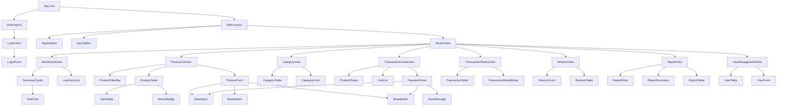
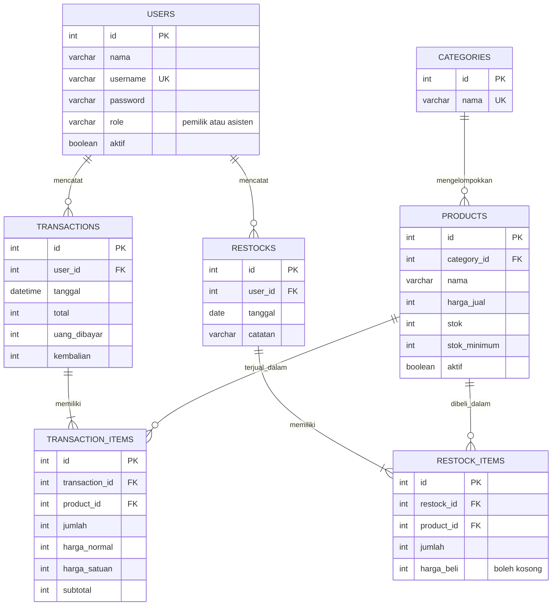

# Bab 2: Perancangan Arsitektur, Komponen, dan Desain

Semua nama dan angka pada contoh adalah data contoh, bukan data asli kios.

## 2.1 Diagram Hirarki Komponen

Halaman (views) hanya merakit komponen fitur, dan semua komponen fitur memakai komponen common yang sama. AuthLayout dipakai halaman login, MainLayout dipakai delapan halaman lainnya. ForbiddenView (akses ditolak) dan NotFoundView (halaman tidak ditemukan) melengkapi daftar halaman.

Halaman yang bisa dibuka Asisten: Login, Produk, dan Transaksi Baru. Halaman lain hanya untuk Pemilik.

**Pohon komponen (teks)**

```text
App.vue
├── layouts/
│   ├── AuthLayout.vue
│   │   └── views/LoginView.vue
│   │       └── features/auth/LoginForm.vue
│   └── MainLayout.vue
│       ├── common/AppSidebar.vue
│       ├── common/AppTopbar.vue
│       └── <RouterView> (halaman di bawah)
│
├── views/ (tingkat halaman, hanya merakit komponen)
│   ├── DashboardView          → SummaryCards, LowStockList
│   ├── ProductListView        → ProductFilterBar, ProductTable, ProductForm
│   ├── CategoryView           → CategoryTable, CategoryForm
│   ├── TransactionCreateView  → ProductPicker, CartList, PaymentPanel
│   ├── TransactionHistoryView → TransactionTable, TransactionDetailModal
│   ├── RestockView            → RestockForm, RestockTable
│   ├── ReportView             → ReportFilter, ReportSummary, ReportTable
│   ├── UserManagementView     → UserTable, UserForm
│   └── ForbiddenView, NotFoundView
│
└── common/ (dipakai lintas fitur)
    BaseButton, BaseInput, BaseSelect, BaseModal, ConfirmDialog,
    DataTable, StatCard, StatusBadge, AlertMessage, EmptyState, PageHeader
```

**Pohon komponen (Mermaid)**



**Prinsip pembagian (usulan):** views hanya merakit komponen dan membaca atau menulis lewat store Pinia. Komponen features berisi tampilan khusus satu fitur. Komponen common tidak mengenal bisnis (tidak tahu apa itu "produk"). Store Pinia yang dirujuk: authStore, productStore, categoryStore, transactionStore, restockStore, userStore (detail di Bab 3).

### Komponen reusable: props dan emits utama

**Common**

| Komponen | Props utama | Emits utama |
|---|---|---|
| BaseButton | label, variant (primary/secondary/danger), disabled, loading | click |
| BaseInput | modelValue, label, type, error, placeholder | update:modelValue |
| BaseSelect | modelValue, label, options, error | update:modelValue |
| BaseModal | open, title | close |
| ConfirmDialog | open, message, confirmLabel | confirm, cancel |
| DataTable | columns, rows, emptyText | row-click |
| StatCard | title, value, variant | (tidak ada) |
| StatusBadge | status (aman/menipis/habis/aktif/nonaktif) | (tidak ada) |
| AlertMessage | type (sukses/peringatan/bahaya), message | dismiss |
| EmptyState | message | (tidak ada) |
| PageHeader | title, subtitle | (tidak ada) |

**Features**

| Komponen | Props utama | Emits utama |
|---|---|---|
| LoginForm | errorMessage | submit (username, password) |
| ProductFilterBar | categories, keyword, categoryId, onlyLowStock | update:filter |
| ProductTable | products, canEdit (false untuk Asisten) | edit, deactivate |
| ProductForm | product (kosong = tambah), categories, errors | submit, cancel |
| ProductPicker | products, keyword | add-to-cart (produk) |
| CartList | items (harga per barang dapat diubah saat tawar-menawar) | update-qty, update-price, remove-item |
| PaymentPanel | total, error | pay (uang dibayar) |
| RestockForm | products | submit, cancel |
| ReportFilter | mode (harian/bulanan), value | change |
| SummaryCards | summary | (tidak ada) |
| UserForm | user, errors | submit, cancel |

Komponen yang menerima canEdit memungkinkan satu komponen dipakai Pemilik dan Asisten tanpa menggandakan kode.

## 2.2 Pemetaan Halaman, Role, Fitur, dan Spesifikasi API

Konvensi (usulan): base path `/api/v1`. Ini kontrak rancangan, sedangkan implementasinya memakai Pinia dan localStorage, sehingga setiap "endpoint" dipanggil lewat aksi store.

| Nama Halaman (route) | Role Pengakses | Nama Fitur | Endpoint API | Method |
|---|---|---|---|---|
| Login (/login) | Semua | Masuk | /api/v1/auth/login | POST |
| Login (/login) | Semua | Keluar | /api/v1/auth/logout | POST |
| Dashboard (/dashboard) | Pemilik | Ringkasan penjualan hari ini | /api/v1/reports/daily | GET |
| Dashboard (/dashboard) | Pemilik | Daftar stok menipis | /api/v1/products?stok_menipis=true | GET |
| Produk (/produk) | Pemilik, Asisten | Tampilkan dan cari produk | /api/v1/products | GET |
| Produk (/produk) | Pemilik, Asisten | Daftar kategori (untuk filter) | /api/v1/categories | GET |
| Produk (/produk) | Pemilik | Tambah produk | /api/v1/products | POST |
| Produk (/produk) | Pemilik | Ubah produk dan harga | /api/v1/products/{id} | PUT |
| Produk (/produk) | Pemilik | Nonaktifkan produk | /api/v1/products/{id} | DELETE |
| Kategori (/kategori) | Pemilik | Tambah kategori | /api/v1/categories | POST |
| Kategori (/kategori) | Pemilik | Ubah kategori | /api/v1/categories/{id} | PUT |
| Kategori (/kategori) | Pemilik | Hapus kategori | /api/v1/categories/{id} | DELETE |
| Transaksi Baru (/transaksi/baru) | Pemilik, Asisten | Catat transaksi tunai (harga per barang dapat diubah saat tawar-menawar) | /api/v1/transactions | POST |
| Riwayat Transaksi (/transaksi) | Pemilik | Tampilkan riwayat | /api/v1/transactions | GET |
| Riwayat Transaksi (/transaksi) | Pemilik | Detail satu transaksi | /api/v1/transactions/{id} | GET |
| Restock (/restock) | Pemilik | Catat barang masuk dari grosir | /api/v1/restocks | POST |
| Restock (/restock) | Pemilik | Tampilkan riwayat restock | /api/v1/restocks | GET |
| Laporan (/laporan) | Pemilik | Laporan harian | /api/v1/reports/daily | GET |
| Laporan (/laporan) | Pemilik | Laporan bulanan | /api/v1/reports/monthly | GET |
| Kelola Akun (/akun) | Pemilik | Tampilkan akun | /api/v1/users | GET |
| Kelola Akun (/akun) | Pemilik | Tambah akun Asisten | /api/v1/users | POST |
| Kelola Akun (/akun) | Pemilik | Ubah atau nonaktifkan akun | /api/v1/users/{id} | PUT |
| Akses Ditolak (/403) | Semua | Pesan akses ditolak | (tidak ada) | - |

Format respons (usulan): sukses `{ "status": "success", "message": "...", "data": {...} }`, gagal `{ "status": "error", "message": "...", "errors": [{ "field": "...", "message": "..." }] }`. Pembuatan data memakai kode 201, login dan GET memakai 200. Penolakan role (403) ditangani Vue Router di sisi frontend.

### Spesifikasi detail endpoint penting

**1. Login**

```json
POST /api/v1/auth/login

Request:
{ "username": "contoh_pemilik", "password": "contoh123" }

Sukses (200):
{ "status": "success", "message": "Login berhasil",
  "data": { "user": { "id": 1, "nama": "Contoh Pemilik", "role": "pemilik" } } }

Gagal (400):
{ "status": "error", "message": "Username atau kata sandi salah",
  "errors": [{ "field": "password", "message": "Kata sandi tidak sesuai" }] }
```

**2. Tambah produk**

```json
POST /api/v1/products

Request:
{ "nama": "Contoh Barang A", "category_id": 1, "harga_jual": 15000,
  "stok": 20, "stok_minimum": 5 }

Sukses (201):
{ "status": "success", "message": "Produk berhasil ditambahkan",
  "data": { "id": 7, "nama": "Contoh Barang A", "category_id": 1,
            "harga_jual": 15000, "stok": 20, "stok_minimum": 5, "aktif": true } }

Gagal (400):
{ "status": "error", "message": "Data produk tidak valid",
  "errors": [{ "field": "harga_jual", "message": "Harga harus lebih dari 0" }] }
```

**3. Catat transaksi (dengan tawar-menawar)**

`harga_satuan` adalah harga yang disepakati. `harga_normal` diisi sistem dari harga jual produk saat transaksi.

```json
POST /api/v1/transactions

Request:
{ "items": [ { "product_id": 7, "jumlah": 2, "harga_satuan": 40000 } ],
  "uang_dibayar": 100000 }

Sukses (201):
{ "status": "success", "message": "Transaksi tercatat",
  "data": { "id": 31, "tanggal": "2026-11-11T08:15:00", "user_id": 2,
            "total": 80000, "uang_dibayar": 100000, "kembalian": 20000,
            "items": [ { "product_id": 7, "jumlah": 2, "harga_normal": 45000,
                         "harga_satuan": 40000, "subtotal": 80000 } ] } }

Gagal (400):
{ "status": "error", "message": "Transaksi tidak dapat diproses",
  "errors": [ { "field": "items[0].jumlah", "message": "Stok tidak mencukupi" },
              { "field": "items[0].harga_satuan", "message": "Harga harus lebih dari 0" },
              { "field": "uang_dibayar", "message": "Uang dibayar kurang dari total" } ] }
```

Efek samping (usulan): stok tiap produk berkurang sesuai jumlah. Penolakan lain: keranjang kosong, jumlah 0 atau negatif. Bila harga beli tercatat dan harga disepakati lebih rendah darinya, tampilan hanya memberi peringatan dan tidak menolak transaksi.

**4. Catat restock (barang masuk dari grosir)**

```json
POST /api/v1/restocks

Request:
{ "tanggal": "2026-11-10", "catatan": "Contoh belanja grosir",
  "items": [ { "product_id": 7, "jumlah": 12, "harga_beli": 10000 } ] }

Sukses (201):
{ "status": "success", "message": "Barang masuk tercatat",
  "data": { "id": 4, "tanggal": "2026-11-10", "user_id": 1,
            "items": [ { "product_id": 7, "jumlah": 12, "harga_beli": 10000 } ] } }

Gagal (400):
{ "status": "error", "message": "Data restock tidak valid",
  "errors": [ { "field": "items[0].jumlah", "message": "Jumlah harus lebih dari 0" } ] }
```

`harga_beli` boleh dikosongkan (sesuai keputusan Bab 1). Efek samping: stok produk bertambah.

**5. Laporan harian**

```json
GET /api/v1/reports/daily?tanggal=2026-11-11

Sukses (200):
{ "status": "success", "message": "Laporan harian",
  "data": { "tanggal": "2026-11-11", "jumlah_transaksi": 12, "total_penjualan": 450000,
            "barang_terjual": [ { "product_id": 7, "nama": "Contoh Barang A", "jumlah": 8 } ] } }

Gagal (400):
{ "status": "error", "message": "Parameter tidak valid",
  "errors": [ { "field": "tanggal", "message": "Format tanggal harus YYYY-MM-DD" } ] }
```

**6. Tambah akun**

```json
POST /api/v1/users

Request:
{ "nama": "Contoh Asisten", "username": "contoh_asisten",
  "password": "contoh123", "role": "asisten" }

Sukses (201):
{ "status": "success", "message": "Akun berhasil dibuat",
  "data": { "id": 2, "nama": "Contoh Asisten", "username": "contoh_asisten",
            "role": "asisten", "aktif": true } }

Gagal (400):
{ "status": "error", "message": "Data akun tidak valid",
  "errors": [ { "field": "username", "message": "Username sudah dipakai" } ] }
```

Endpoint lain (kategori, ubah produk, ubah akun) memakai pola yang sama. Aturan khusus (usulan): kategori yang masih dipakai produk tidak bisa dihapus (400). Produk yang sudah pernah terjual hanya dinonaktifkan (`aktif = false`), tidak dihapus, supaya riwayat transaksi tetap utuh.

## 2.3 Desain Basis Data (ERD)

Basis data terdiri dari tujuh tabel yang ternormalisasi (3NF). Rekap harian tidak punya tabel sendiri karena dihitung dari tabel transactions berdasarkan tanggal. Tabel header (transactions, restocks) dan tabel item dipisah agar satu nota atau satu belanja grosir bisa memuat banyak barang.



### Penjelasan relasi

| Relasi | Kardinalitas | Penjelasan sesuai proses nyata |
|---|---|---|
| categories → products | 1 : N | Satu kategori memuat banyak produk. Satu produk punya satu kategori. |
| users → transactions | 1 : N | Satu pengguna (Pemilik atau Asisten) bisa mencatat banyak transaksi, sehingga terlihat siapa yang melayani. |
| transactions → transaction_items | 1 : N (minimal 1) | Satu transaksi (satu nota) berisi satu atau lebih barang. |
| products → transaction_items | 1 : N | Satu produk bisa muncul di banyak transaksi. |
| users → restocks | 1 : N | Pemilik mencatat banyak kali belanja grosir. |
| restocks → restock_items | 1 : N (minimal 1) | Satu kali belanja grosir bisa berisi beberapa barang. |
| products → restock_items | 1 : N | Satu produk bisa dibeli ulang berkali-kali. |

### Catatan rancangan (usulan)

- `harga_satuan` di transaction_items menyimpan harga yang disepakati saat tawar-menawar, sedangkan `harga_normal` menyimpan harga jual produk saat itu. Dengan begitu riwayat tidak berubah bila harga produk diubah kemudian, dan selisih tawar-menawar bisa dilaporkan.
- Nilai rupiah disimpan sebagai bilangan bulat (tanpa sen).
- `stok_minimum` ditentukan per produk, dengan nilai awal 5 bila tidak diisi.
- Produk tidak dihapus tetapi dinonaktifkan (`aktif = false`) agar riwayat transaksi tetap utuh.
- Karena aplikasi hanya frontend, `password` yang tersimpan di localStorage tidak aman untuk produksi. Tulis ini sebagai keterbatasan sistem di laporan.

## 2.4 Perancangan UI/UX dan Style Guide (usulan)

**Palet warna**

| Peran | HEX | Catatan |
|---|---|---|
| Primary | #1F6F5C | Tombol utama, sidebar aktif (teks putih di atasnya cukup kontras) |
| Secondary | #E9F2EF | Latar kartu dan item sidebar non-aktif |
| Sukses | #2E9E5B | Transaksi berhasil, stok aman |
| Peringatan | #F5A524 | Stok menipis (teks gelap di atasnya) |
| Bahaya | #D64545 | Error, hapus, stok habis |
| Teks utama | #1F2933 | |
| Latar halaman | #F5F7F6 | |
| Garis / border | #D9E0DD | |

**Tipografi**

| Elemen | Ukuran | Ketebalan |
|---|---|---|
| Font family: Inter, cadangan system-ui, Arial, sans-serif | - | - |
| Judul halaman (H1) | 28px | 600 |
| Subjudul (H2) | 22px | 600 |
| Judul bagian (H3) | 18px | 600 |
| Teks isi | 16px | 400 |
| Teks kecil / label | 14px | 400 |
| Keterangan | 12px | 400 |

Tambahan: spasi kelipatan 8px, sudut membulat 8px, tinggi tombol minimal 44px agar mudah ditekan di layar sentuh.

### Wireframe (rancangan awal)

Wireframe berikut berupa rancangan awal tata letak. Tampilan akhir aplikasi boleh menyesuaikan.

**Wireframe 1: tata letak umum (semua halaman setelah login)**

```text
┌────────────────────────────────────────────────────────────┐
│ Nama Usaha [ISI]                  Contoh Asisten  [Keluar] │
├──────────────┬─────────────────────────────────────────────┤
│ MENU         │ Judul Halaman                               │
│              │ Subjudul halaman                            │
│ Dashboard *  │ ─────────────────────────────────────────── │
│ Produk       │                                             │
│ Transaksi    │          (area konten halaman)              │
│ Riwayat *    │                                             │
│ Restock *    │                                             │
│ Laporan *    │                                             │
│ Kategori *   │                                             │
│ Akun *       │                                             │
│              │                                             │
└──────────────┴─────────────────────────────────────────────┘
* hanya tampil untuk Pemilik
```

**Wireframe 2: halaman Transaksi Baru (area konten)**

```text
┌──────────────────────────────────────────────────────────────────────┐
│ Transaksi Baru                                                       │
│ Catat penjualan tunai                                                │
│                                                                      │
│ ┌ Daftar Produk ──────────────────┐ ┌ Keranjang ───────────────────┐ │
│ │ [Cari nama produk.........]     │ │ Contoh Daster A              │ │
│ │ Kategori: [Semua      ▾]        │ │ Jml [-2+] Harga [40.000]     │ │
│ │ ─────────────────────────────── │ │ Normal Rp 45.000 (nego)      │ │
│ │ Contoh Daster A       Rp 45.000 │ │ Subtotal Rp 80.000           │ │
│ │ Stok 12              [+ Tambah] │ │ ──────────────────────────── │ │
│ │ Contoh Baskom B       Rp 15.000 │ │ Total      Rp 80.000         │ │
│ │ Stok 30              [+ Tambah] │ │ Uang dibayar [100.000]       │ │
│ │ Contoh Pakaian C      Rp 20.000 │ │ Kembalian  Rp 20.000         │ │
│ │ Stok 3 (menipis)     [+ Tambah] │ │ [   Simpan Transaksi   ]     │ │
│ └─────────────────────────────────┘ └──────────────────────────────┘ │
└──────────────────────────────────────────────────────────────────────┘
```

Komponen yang terlihat cocok dengan component tree: ProductFilterBar, ProductPicker, CartList, dan PaymentPanel. Kolom harga di keranjang adalah tempat tawar-menawar.

**Wireframe 3: login**

```text
┌──────────────────────────────────────┐
│           Nama Usaha [ISI]           │
│            Masuk ke Sistem           │
│                                      │
│  Username                            │
│  [____________________________]      │
│  Kata sandi                          │
│  [____________________________]      │
│  ! Pesan error (jika gagal)          │
│  [           Masuk            ]      │
└──────────────────────────────────────┘
```

### Keputusan final Bab 2

| Poin | Keputusan |
|---|---|
| Halaman awal | Pemilik ke Dashboard, Asisten ke Transaksi Baru |
| Hapus produk | Dinonaktifkan, riwayat tetap utuh |
| Restock | Satu belanja grosir bisa berisi banyak barang |
| Stok menipis | Batas per produk (stok_minimum), nilai awal 5 |
| Tawar-menawar | Harga per item bisa diubah saat transaksi oleh Pemilik dan Asisten. Harga master hanya bisa diubah Pemilik |
| Kolom baru | harga_normal di transaction_items. Harga di bawah harga beli hanya memicu peringatan, bukan penolakan |
| Varian pakaian | Satu baris per produk. Ukuran ditulis di nama produk, dicatat sebagai batasan sistem |
| Kategori seed | Tiga kategori umum: Pecah Belah dan Perlengkapan Rumah Tangga, Pakaian, Lainnya. Pemilik bisa menambah kategori |
| Data seed | Sekitar 8 sampai 10 produk berlabel "Contoh ...", harga dan stok adalah angka contoh |
| Style guide | Sesuai draf di atas (Inter, hijau #1F6F5C) |
| Wireframe | Rancangan awal, boleh berubah saat implementasi |
