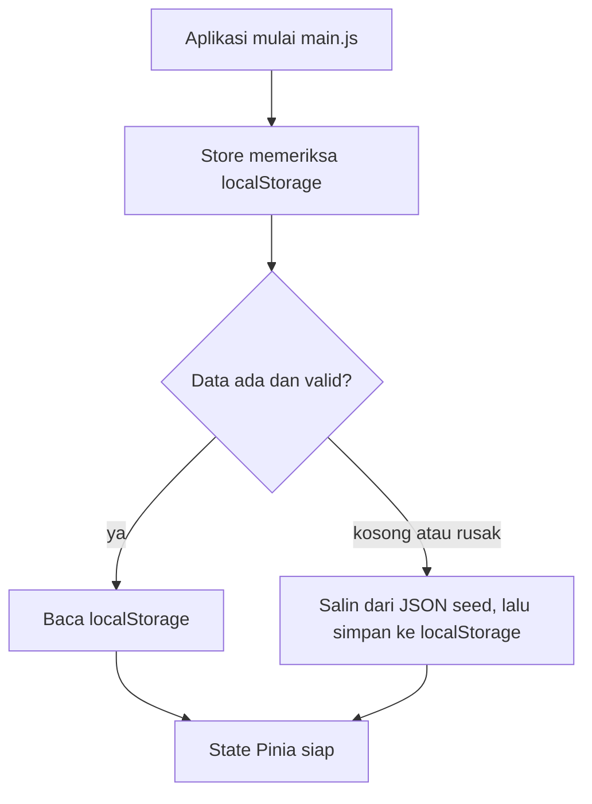

# Bab 3: Implementasi Frontend Vue.js v3 (rancangan 3.1 dan 3.2)

Semua pilihan di bab ini adalah usulan, dan data seed berupa data contoh. Bab 3.3 (tangkapan layar aplikasi) diisi setelah aplikasi jadi.

## 3.1 Struktur Folder Proyek (rancangan)

Setiap folder punya satu tugas, sehingga tampilan, state, data awal, dan akses penyimpanan terpisah.

```text
docs/                      (Bab 1 sampai 3 sebagai acuan agen AI)
src/
├── assets/                (gaya global, logo)
├── components/
│   ├── common/            (BaseButton, DataTable, BaseModal, ...)
│   └── features/
│       ├── auth/          (LoginForm)
│       ├── products/      (ProductTable, ProductForm, ProductFilterBar)
│       ├── categories/
│       ├── transactions/  (ProductPicker, CartList, PaymentPanel, ...)
│       ├── restock/
│       ├── reports/
│       └── users/
├── layouts/               (AuthLayout, MainLayout)
├── views/                 (satu file per halaman, hanya merakit komponen)
├── router/                (index.js, penjaga akses per role)
├── stores/                (auth, product, category, cart, transaction, restock, user)
├── data/seed/             (file JSON data awal)
├── services/              (storage.js: baca dan tulis localStorage)
├── constants/             (role, nama kunci localStorage)
├── utils/                 (format rupiah, format tanggal)
├── App.vue
└── main.js
```

| Folder | Fungsi | Aturan |
|---|---|---|
| components/common | Komponen umum | Tidak mengenal bisnis (tidak tahu apa itu "produk") |
| components/features | Komponen khusus satu fitur | Menerima data lewat props, tidak mengakses store langsung |
| views | Satu file per halaman | Hanya merakit komponen dan memanggil store |
| stores | State dan aksi Pinia | Satu-satunya tempat data berubah |
| data/seed | File JSON data awal | Hanya dibaca saat localStorage kosong |
| services | Akses localStorage | View dan komponen tidak menyentuh localStorage langsung |
| router | Rute dan penjaga role | Satu tempat aturan akses |
| constants, utils | Nama role, kunci storage, format rupiah dan tanggal | Mencegah nilai tertulis berulang (hardcode) |

Store `cart` menyimpan keranjang sementara di Pinia dan memvalidasi checkout sebelum `transactionStore` menyimpan transaksi. `transactionStore` menyediakan daftar transaksi dan item yang dapat dilihat sesuai role aktif.

## 3.2 Mekanisme Data Seed (JSON) dan Persistensi Local Storage

### Daftar file JSON seed

File berada di `src/data/seed/`. Semua isinya data contoh, bukan data asli kios.

| File seed | Isi | Kunci localStorage (usulan) |
|---|---|---|
| users.json | 2 akun contoh (Pemilik dan Asisten) | kios_users |
| categories.json | 3 kategori awal | kios_categories |
| products.json | sekitar 8 sampai 10 produk berlabel "Contoh ..." | kios_products |
| transactions.json | beberapa transaksi contoh agar laporan tidak kosong | kios_transactions |
| transaction_items.json | item untuk transaksi contoh | kios_transaction_items |
| restocks.json | 1 sampai 2 restock contoh | kios_restocks |
| restock_items.json | item untuk restock contoh | kios_restock_items |

Sesi login disimpan di kunci kios_session.

**Contoh isi** (komentar `//` hanya penanda file, bukan bagian JSON)

```json
// users.json
[
  { "id": 1, "nama": "Contoh Pemilik", "username": "contoh_pemilik", "password": "contoh123", "role": "pemilik", "aktif": true },
  { "id": 2, "nama": "Contoh Asisten", "username": "contoh_asisten", "password": "contoh123", "role": "asisten", "aktif": true }
]

// categories.json
[
  { "id": 1, "nama": "Pecah Belah dan Perlengkapan Rumah Tangga" },
  { "id": 2, "nama": "Pakaian" },
  { "id": 3, "nama": "Lainnya" }
]

// products.json
[
  { "id": 1, "category_id": 1, "nama": "Contoh Sapu", "harga_jual": 15000, "stok": 20, "stok_minimum": 5, "aktif": true },
  { "id": 2, "category_id": 2, "nama": "Contoh Daster", "harga_jual": 45000, "stok": 12, "stok_minimum": 5, "aktif": true }
]

// transactions.json dan transaction_items.json
[ { "id": 1, "user_id": 2, "tanggal": "2026-11-10T08:15:00", "total": 80000, "uang_dibayar": 100000, "kembalian": 20000, "status": "selesai", "alasan_batal": null, "dibatalkan_oleh": null } ]
[ { "id": 1, "transaction_id": 1, "product_id": 2, "jumlah": 2, "harga_normal": 45000, "harga_satuan": 40000, "subtotal": 80000 } ]

// restocks.json dan restock_items.json
[ { "id": 1, "user_id": 1, "tanggal": "2026-11-09", "catatan": "Contoh belanja grosir" } ]
[ { "id": 1, "restock_id": 1, "product_id": 1, "jumlah": 12, "harga_beli": 10000 } ]
```

Struktur kolom mengikuti ERD di bab2-perancangan.md (bagian 2.3).

### Alur inisialisasi Pinia Store



1. `main.js` membuat aplikasi dan mendaftarkan Pinia serta Vue Router.
2. Setiap store menjalankan fungsi inisialisasi saat dimuat.
3. Fungsi itu memeriksa kunci miliknya di localStorage, misalnya kios_products.
4. Bila kunci ada dan isinya valid, data dibaca ke state Pinia.
5. Bila kunci kosong atau JSON rusak, data disalin dari file seed ke state, lalu disimpan ke localStorage.
6. Setiap aksi tambah, ubah, atau hapus mengubah state, lalu menulis ulang ke localStorage lewat services/storage.js.
7. Saat halaman dimuat ulang, langkah 3 dan 4 berjalan lagi sehingga data tetap ada.

### Usulan tambahan (menunggu persetujuan mahasiswa)

| Usulan | Manfaat |
|---|---|
| Sesi login disimpan di localStorage | Pengguna tetap login setelah halaman dimuat ulang |
| Tombol "Atur ulang data" khusus Pemilik | Mengembalikan semua data ke seed, berguna saat pengujian dan demo |
